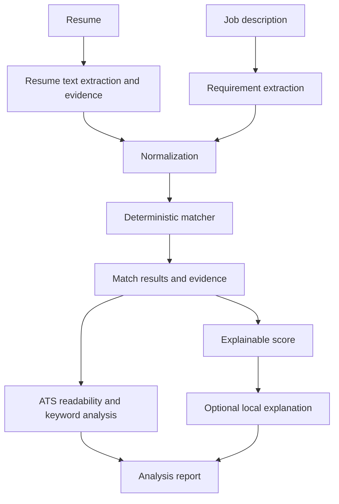

# Local ATS Scorer

Local-first, ATS-style resume-to-job-description matching and resume analysis.

The application answers one focused question: **how closely does this resume match this specific job description, and what evidence supports that result?** It does not rank people, predict hiring outcomes, or provide an official universal ATS score.

## Features

- PDF, DOC, DOCX, and TXT resume extraction with Apache Tika
- Structured job requirement and resume evidence matching
- Normalized aliases such as `LLM` / `Large Language Models`, `RAG` / `Retrieval-Augmented Generation`, `JS` / `JavaScript`, and `Postgres` / `PostgreSQL`
- Required, preferred, partial, and missing requirement classifications
- Deterministic, configurable, reproducible score breakdown
- Evidence snippets and source sections for important matches
- Separate ATS readability, keyword, stuffing, and resume-improvement views
- Optional local LM Studio embeddings and explanations
- Deterministic fallback when the local model or vector service is unavailable

## Architecture



The primary endpoint is `POST /api/ats/analyze` with multipart fields `jobTitle`, `jobDescription`, and `resume`. It returns `overallScore`, `breakdown`, matched/partial/missing requirements, evidence, ATS readability, keyword analysis, recommendations, and an optional local explanation.

The legacy `POST /api/scores` endpoint remains available while existing stored history is migrated. The new frontend uses `/api/ats/analyze`.

## Scoring Methodology

The number is an application-specific **Resume Match Score**. It is not an industry-standard or official ATS score. Default weights are configurable in `application.yml`:

- Required skills: 40
- Preferred skills: 15
- Experience: 15
- Project relevance: 10
- Education: 5
- Semantic relevance: 10
- ATS readability: 5

Every component exposes its percentage, weight, and point contribution. Exact and normalized matches are evidence-backed. Partial contextual evidence counts at half strength. Repeated keywords do not produce repeated credit; the keyword analysis reports mention counts and possible stuffing warnings.

Projects are treated as technical evidence, not automatically as professional employment. Missing requirements produce recommendations that ask the user to add truthful evidence, never to invent experience or stuff keywords.

## Local AI and Privacy

Parsing and deterministic matching work without an LLM. LM Studio is optional and can provide embeddings or a concise explanation. The final score is calculated before explanation and is never accepted from the model. The explanation receives the structured result rather than independently scoring raw resume text.

By default, the backend does not persist uploaded resume text. Stored legacy history contains extracted score fields and filenames. Do not claim that data never leaves the machine if a remote model or external service is configured; this project is local-first when its configured services are local.

## Run Locally

Prerequisites: Java 17+, Maven 3.9+, Node.js 20+, and npm.

Run the integrated Java server. Maven builds the frontend and packages it with the backend:

```bash
cd backend
mvn spring-boot:run
```

Open `http://localhost:8081` for the frontend and API.

For frontend hot reload during development, keep the Java server running and start Vite in another terminal:

```bash
cd frontend
npm ci
npm run dev
```

Open `http://localhost:5173`; Vite proxies `/api` requests to Java on port `8081`.

To enable optional local explanations, copy `.env.example` to `.env` and configure the LM Studio base URL and model names.

## Docker Compose

```bash
docker compose up --build
```

This starts PostgreSQL with pgvector and the Spring Boot application, which serves both the API and frontend on port `8080`. The optional LM Studio URL defaults to `host.docker.internal` for a model server running on the host.

## Testing

```bash
cd backend && mvn test
cd ../frontend && npm run build
```

The backend tests cover legacy score behavior plus normalized AI/LLM/RAG matching, required versus preferred requirements, partial evidence, and missing requirements.

## Limitations and Future Improvements

Heuristic extraction is intentionally inspectable but cannot understand every resume layout or domain synonym. Semantic skill embeddings should be added as per-requirement enrichment rather than replacing deterministic evidence. Future work can introduce persisted `JobDescription`, `Resume`, `AtsAnalysis`, and `Evidence` entities, richer section parsing, golden datasets, and pgvector-backed requirement-to-evidence retrieval.
